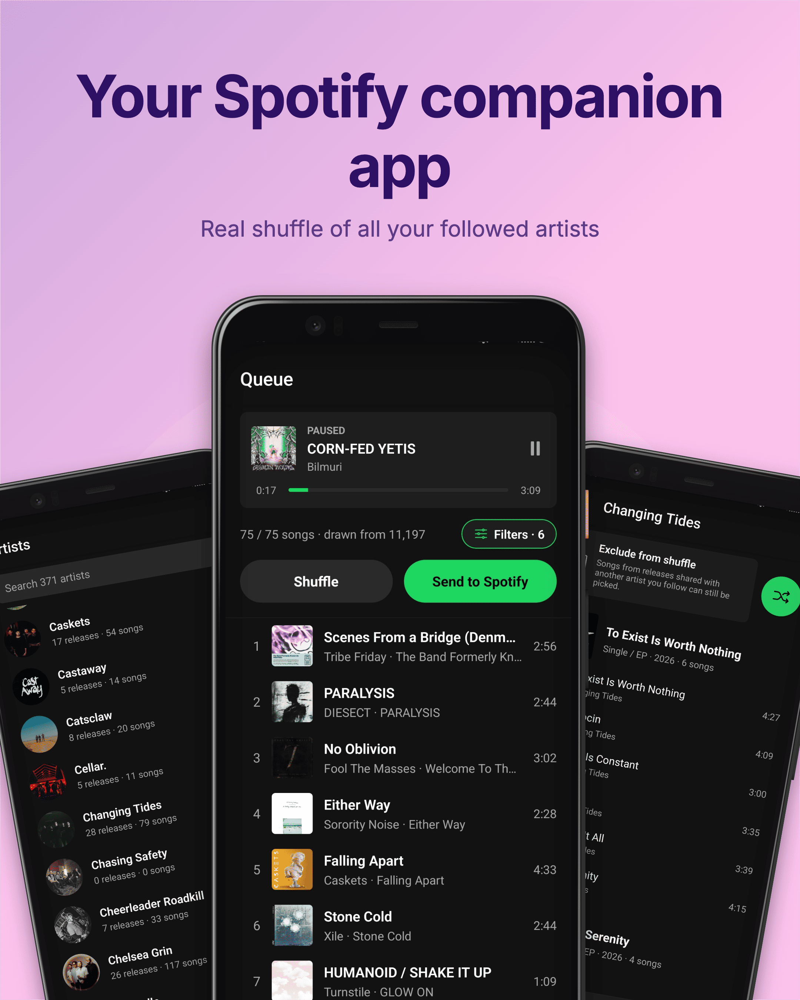

# TrueShuffle

**A truly random shuffle for the artists you follow on Spotify.**

  

  

## Features
- **Truly random queue** – 100 randomly selected songs from your followed artists
- **Send to Spotify** – the queue goes into a private "TrueShuffle" playlist, ready to play or start the playlist directly from the app
- **Filters** – leave out acoustic, remix, live, instrumental or short intro songs from the shuffle
- **Private** – your library is stored only on your phone; you connect with your own
  Spotify developer app, so no third-party server is involved

## Requirements

- Android 7.0 or newer
- A **Spotify premium** account and a developer app (description for the developer app in the app settings)
